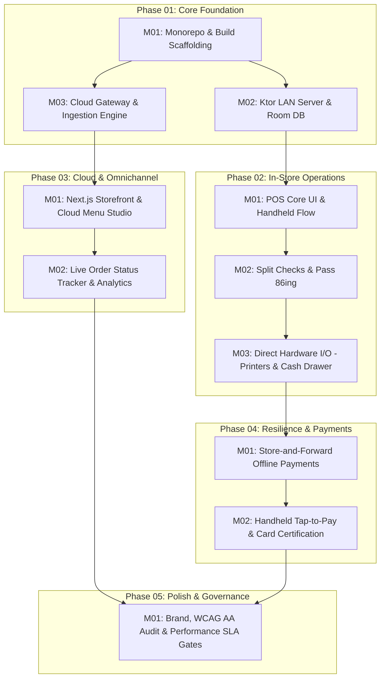

# Master Implementation Dependency Graph — Dinevique Platform

**Parent:** [IMPLEMENTATION_LOG.md](../IMPLEMENTATION_LOG.md)  
**Version:** 1.0.0  
**Last Updated:** 2026-10-19  

---

## 1. Visual Dependency Graph

---

## 2. Milestone Execution Sequencing

1. **Phase 01 — Core Foundation:**
   - `P01_M01` (Sprint 1): Monorepo workspace configuration, Android Gradle multi-module layout, Node.js + Next.js workspace setup, shared TypeScript/Kotlin event schemas.
   - `P01_M02` (Sprint 2): Embedded Ktor HTTP/WebSocket service on Android, Android Room SQLite schema & DAOs, KDB client WebSocket listener.
   - `P01_M03` (Sprint 3): Node.js Cloud Gateway, MongoDB Mongoose schema models, idempotent UUID event ingestion endpoint.
2. **Phase 02 — In-Store Operations:**
   - `P02_M01`: Jetpack Compose POS order entry, table floor plan, Handheld Sunmi V2 3-tap order flow.
   - `P02_M02`: Split checks by seat/N-way, course hold/fire logic, KDB bump micro-interaction, pass 86ing broadcast.
   - `P02_M03`: Native UsbManager, Epson ePOS, StarPRNT SDK integration, cash drawer kick pulse.
3. **Phase 03 — Cloud & Omnichannel:**
   - `P03_M01`: Next.js SSR storefront, modifier drawer rules, Cloud Admin Menu Studio, `MENU_SYNC` broadcast.
   - `P03_M02`: Live customer order status tracker (SSE/WSS), merchant sales and terminal heartbeat dashboard.
4. **Phase 04 — Resilience & Payments:**
   - `P04_M01`: AES-256 GCM offline card queue, risk ceiling controls, auto-drain recovery loop upon WAN restore.
   - `P04_M02`: Handheld contactless payment sled integration, digital SMS/email receipts.
5. **Phase 05 — Polish & Governance:**
   - `P05_M01`: WCAG 2.1 AA accessibility audit, brand voice compliance, end-to-end performance latency benchmark validation.

---
_Document: DEPENDENCY_GRAPH.md | Node: IMPLEMENTATION/PHASES | Parent: [IMPLEMENTATION_LOG.md](../IMPLEMENTATION_LOG.md)_
