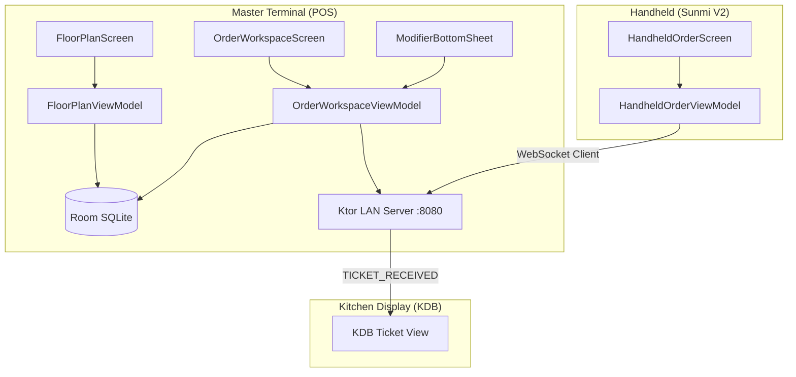
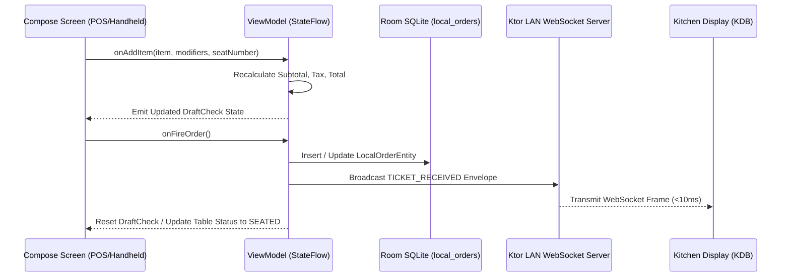

# Sprint Implementation Report & Technical Document: Phase 02 / Milestone 01

**Sprint ID:** `SPRINT_P02_M01`  
**Phase:** Phase 02 — In-Store Operations  
**Milestone:** Milestone 01 — POS Core UI & Handheld Flow  
**Version:** 1.0.0  
**Parent:** [MILESTONE01_INDEX.md](../MILESTONE01_INDEX.md)  
**Status:** 🟡 **DOCUMENT-BEFORE-CODE (DRAFTED FOR IMPLEMENTATION)**  

---

## 1. Executive Summary & Architecture Overview

Sprint `SPRINT_P02_M01` delivers the primary visual and interactive front-of-house interfaces of the Dinevique platform. Built using Kotlin and Jetpack Compose, this milestone bridges the physical restaurant workflow with the edge orchestrator established in Phase 01:
- **POS Master Terminal:** High-resolution split-screen terminal layout designed for 10"–15" landscape touchscreen hardware. Features a live visual floor plan with real-time occupancy and elapsed timers, alongside an order workspace with category browsing, item configuration, and modifier enforcement.
- **Handheld Terminal:** High-speed portrait interface designed for 5"–7" mobile terminals (e.g., Sunmi V2 / V2 Pro). Features a thumb-driven 3-tap order entry flow delegating all operations to the Master Terminal over local LAN WebSockets.
- **Edge Data Pipeline:** Reactive Kotlin `StateFlow` streams bind Compose UI states directly to Room SQLite `LocalOrderEntity` records and dispatch `TICKET_RECEIVED` LAN WebSocket broadcasts to connected Kitchen Display Boards (KDBs).



---

## 2. Table Floor Plan Specification

### 2.1 Table Occupancy State Model
Each table maintains a state machine driven by operational events:

| State | Visual Style | Indicative Badge | Next Allowed Actions |
| :--- | :--- | :--- | :--- |
| `AVAILABLE` | Slate fill (`#1E2A38`), subtle border (`#2D3D50`) | Green indicator, "Ready" | Seat Guests, Open Check |
| `SEATED` | Dark Onyx fill, Brand Amber border (`#D4820A`) | Elapsed timer (`mm:ss`), Server name | Add Items, Fire Courses, Drop Check |
| `CHECK_DROPPED`| Amber tint fill, Warning Ochre border (`#B8860B`)| Total amount (`$XX.XX`), "Bill Dropped" | Take Payment, Split Check |
| `DIRTY` | Muted Gray fill (`#2A2A2A`), Red dot | "Needs Busing", Server initials | Mark Cleaned / Bus Table |

### 2.2 Table Layout & Data Model
```kotlin
data class TableUiModel(
    val tableId: String,
    val tableLabel: String,
    val section: String, // "MAIN_DINING", "PATIO", "BAR"
    val capacity: Int,
    val currentGuests: Int = 0,
    val status: TableStatus,
    val serverName: String? = null,
    val seatedAtEpochMs: Long? = null,
    val activeCheckUuid: String? = null,
    val activeCheckTotalCents: Long = 0
)

enum class TableStatus {
    AVAILABLE,
    SEATED,
    CHECK_DROPPED,
    DIRTY
}
```

---

## 3. POS Order Workspace Specification

### 3.1 Two-Pane Layout Architecture
The POS Order Workspace operates in a split-screen configuration:
1. **Left Pane (40% width / min 400dp):**
   - **Header:** Table identifier, Server badge, Guest count, Order UUID.
   - **Order Item List:** Scrollable list of ordered items grouped by seat or course. Displays item name, quantity, unit price, modifier summary chips, and course hold status (`HOLD` vs. `FIRE`).
   - **Check Summary Footer:** Subtotal, Tax (configurable rate, e.g., 8.25%), Tip (if applied), and Grand Total formatted with tabular numbers.
   - **Action Bar:** "Hold All", "Fire Courses", "Split Check", "Print Check", "Pay".
2. **Right Pane (60% width):**
   - **Category Tab Row:** Horizontally scrollable category chips (`Appetizers`, `Entrees`, `Desserts`, `Beverages`, `Cocktails`).
   - **Menu Item Grid:** Adaptive grid (3 columns on standard, 4 on wide) of product cards showing item name, base price, prep station tag (`GRILL`, `BAR`, `EXPO`), and 86'd status overlay.

### 3.2 Modifier Selection Bottom Sheet
When an item with modifiers is tapped:
1. Bottom sheet slides up over the right pane.
2. Displays item name, description, and base price.
3. Groups modifier categories into:
   - **Single-Select / Required:** Radio buttons (e.g., "Meat Temperature: Rare, Medium Rare, Medium, Well Done").
   - **Multi-Select / Optional:** Checkboxes with price deltas (e.g., "Add Bacon (+$2.50)", "Gluten-Free Bun (+$1.50)").
4. Validation prevents the "Add to Order" CTA from enabling until all required modifier groups have at least `minSelection` options selected.
5. Dynamic total recalculates on every selection:
   $$\text{ItemTotalCents} = \text{BasePriceCents} + \sum \text{SelectedModifierPriceDeltaCents}$$

---

## 4. Handheld 3-Tap Order Entry Specification

### 4.1 Sunmi V2 Form Factor Optimization
- Screen width: 720px (approx. 5.5" diagonal), high-density touch.
- Thumb reach zone: All primary navigation chips and action buttons are placed in the bottom 60% of the screen.
- Touch targets: Strictly $\ge 56\text{dp} \times 56\text{dp}$ for one-handed operation.

### 4.2 The 3-Tap Flow Sequence
1. **Tap 1 (Category / Item Selection):** Waitstaff taps a category chip or item card directly from the high-velocity quick grid.
2. **Tap 2 (Modifier Confirmation):** If the item has required modifiers, a compact bottom sheet opens; tap the desired option (default selection pre-highlighted).
3. **Tap 3 (Fire Order):** Waitstaff taps the persistent bottom bar "SEND TO KITCHEN" button. The order is committed locally, packaged into a `TICKET_RECEIVED` event, and transmitted over the local WebSocket to the Master Terminal.

---

## 5. State Management & Data Flow



---

## 6. Verification & Test Plan

1. **Table Occupancy State Tests:**
   - Verify table transitions from `AVAILABLE` to `SEATED` on opening check.
   - Verify elapsed timer increments accurately.
   - Verify transition to `CHECK_DROPPED` upon bill request.
   - Verify transition to `DIRTY` upon payment completion.
2. **Modifier Validation & Calculation Tests:**
   - Verify `minSelection` constraint enforcement (button disabled until satisfied).
   - Verify penny-perfect price delta accumulation:
     $$\text{Base } \$14.00 + \text{Bacon } \$2.50 + \text{Cheddar } \$1.00 = \$17.50$$
   - Verify tax calculation ($17.50 \times 8.25\% = \$1.44 \implies \text{Total } \$18.94$).
3. **Handheld 3-Tap Sequence Test:**
   - Simulate tap events in exact 3-step sequence.
   - Verify JSON payload emission matching `TICKET_RECEIVED` contract.

---
_Technical Document | Parent: [MILESTONE01_INDEX.md](../MILESTONE01_INDEX.md) | Status: APPROVED FOR CODE_
