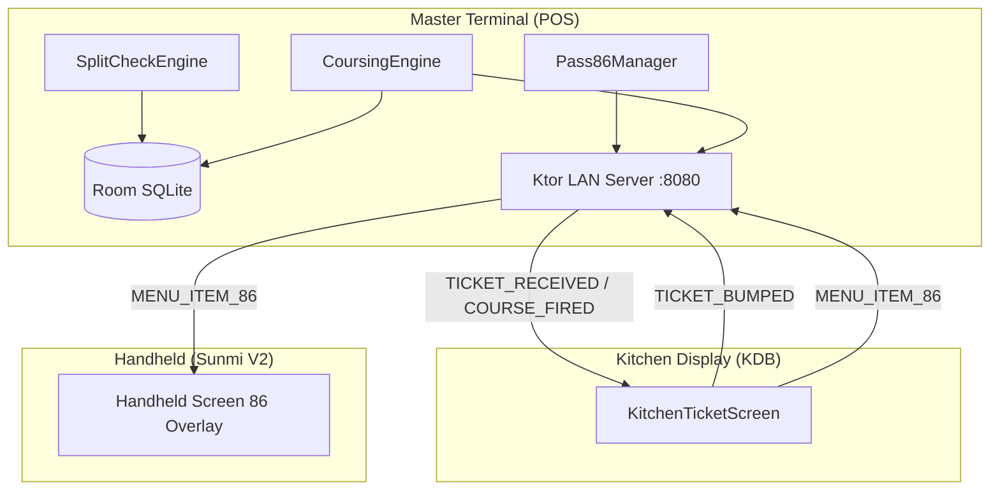
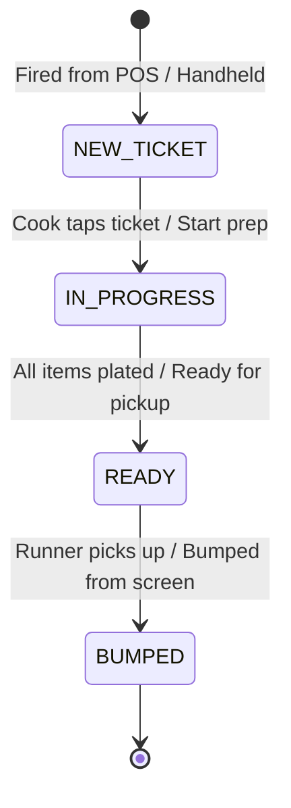

# Sprint Implementation Report & Technical Document: Phase 02 / Milestone 02

**Sprint ID:** `SPRINT_P02_M02`  
**Phase:** Phase 02 — In-Store Operations  
**Milestone:** Milestone 02 — Split Checks & Pass 86ing  
**Version:** 1.0.0  
**Parent:** [MILESTONE02_INDEX.md](../MILESTONE02_INDEX.md)  
**Status:** 🟡 **DOCUMENT-BEFORE-CODE (DRAFTED FOR IMPLEMENTATION)**  

---

## 1. Executive Summary & Architecture Overview

Sprint `SPRINT_P02_M02` delivers critical high-volume operational workflows required in full-service and fast-casual hospitality environments:
- **Split Check Engine:** Provides mathematical penny-perfect division across $N$ parties ($2 \le N \le 20$) and seat-level item separation, with independent multi-tender payment recording.
- **Coursing Engine:** Manages course hold/fire states (`HOLD` vs `FIRE`), ensuring the kitchen only receives tickets when items are ready to be prepared, reducing food wastage and pacing dining experiences.
- **Kitchen Display (KDB) Ticket Flow:** 4-stage lifecycle management (`NEW_TICKET` $\rightarrow$ `IN_PROGRESS` $\rightarrow$ `READY` $\rightarrow$ `BUMPED`) with station routing (`GRILL`, `FRY`, `SALAD`, `BAR`, `EXPO`) and one-tap bump interactions.
- **Pass 86ing Engine:** Real-time item availability toggling with sub-200ms LAN synchronization across POS, Handheld, and Kitchen terminals.



---

## 2. Split Check Specification & Mathematical Proof

### 2.1 Penny-Perfect Even $N$-Way Split Algorithm
When splitting a check of total cents $T$ and tax cents $T_{\text{tax}}$ across $N$ parties:

1. **Base Total Allocation:**
   $$B = \left\lfloor \frac{T}{N} \right\rfloor, \quad R = T \pmod N$$
2. **Per-Check Total Calculation:**
   $$\text{CheckTotal}_i = \begin{cases} B + 1 & \text{if } 1 \le i \le R \\ B & \text{if } R < i \le N \end{cases}$$
3. **Proof of Zero Discrepancy:**
   $$\sum_{i=1}^N \text{CheckTotal}_i = \sum_{i=1}^R (B + 1) + \sum_{i=R+1}^N B = R(B + 1) + (N - R)B = RB + R + NB - RB = NB + R = T$$
   Therefore, the discrepancy is mathematically guaranteed to be **0 cents** for all positive integers $T$ and $N \ge 1$.

4. **Tax and Subtotal Partitioning:**
   Similarly, base tax $B_{\text{tax}} = \lfloor T_{\text{tax}} / N \rfloor$ and remainder $R_{\text{tax}} = T_{\text{tax}} \pmod N$.
   $$\text{CheckTax}_i = \begin{cases} B_{\text{tax}} + 1 & \text{if } 1 \le i \le R_{\text{tax}} \\ B_{\text{tax}} & \text{if } R_{\text{tax}} < i \le N \end{cases}$$
   $$\text{CheckSubtotal}_i = \text{CheckTotal}_i - \text{CheckTax}_i$$

### 2.2 Seat-Based Check Separation
- Each `DraftOrderItem` has an associated `seatNumber` ($1 \dots M$).
- Splitting by seat partitions the check into $M$ child checks:
  $$C_s = \{ \text{item} \in \text{Check.items} \mid \text{item.seatNumber} = s \}$$
- For each child check $C_s$, subtotal is the sum of items, and tax is computed as $\text{round}(\text{Subtotal}_s \times \text{TaxRate})$.
- Shared items (e.g., appetizers) can be assigned to a designated party or split evenly.

---

## 3. Course Hold & Fire Specification

### 3.1 Course Lifecycle & States
Every item belongs to a course category and holds an execution state:
- `CourseCategory`: `BEVERAGE`, `APPETIZER`, `ENTREE`, `DESSERT`.
- `CourseHoldState`: `HOLD` (remain in holding queue) vs `FIRE` (dispatched to kitchen).

### 3.2 Firing Execution
1. At initial order creation, items tagged `HOLD` are saved in Room SQLite with `ticket_status = 'HELD'`.
2. When the server taps "Fire Entrees", the POS updates those items' state to `FIRE` and emits a `COURSE_FIRED` LAN event.
3. Connected KDBs receive the payload and display the ticket with an animated "NEW COURSE FIRED" banner.

---

## 4. Kitchen Display (KDB) Bump Flow Specification

### 4.1 4-Stage Ticket State Machine


### 4.2 Station-Based Routing
Tickets are filtered on each physical KDB station:
- `GRILL`: Steaks, Burgers, Chops.
- `FRY`: Calamari, Truffle Fries.
- `SALAD`: Carpaccio, Caesar, Cold apps.
- `BAR`: Cocktails, Beers, Wines.
- `EXPO`: Master kitchen display showing all stations with consolidated table status.

---

## 5. Pass 86ing Specification

### 5.1 One-Tap 86ing Workflow
1. Manager or Expeditor at POS or KDB long-presses any menu item or opens the "86 Management" drawer.
2. Toggling an item to `86'd` immediately sets `isAvailable = false`.
3. An encrypted LAN WebSocket frame `MENU_ITEM_86` is broadcast across port 8080:
   ```json
   {
     "eventId": "evt-86-9812",
     "eventType": "MENU_ITEM_86",
     "restaurantId": "rest_active",
     "timestampEpochMs": 1700000000000,
     "payloadJson": "{\"itemId\":\"item_ribeye\",\"name\":\"USDA Prime Ribeye\",\"isAvailable\":false}"
   }
   ```
4. All connected terminals receive the frame within $< 200\text{ms}$.
5. POS and Handheld interfaces mark the product card with a red "86'D / SOLD OUT" badge, disable touch interactions, and prevent adding it to draft checks.

---

## 6. Verification & Test Plan

1. **Penny-Perfect Split Verification:**
   - Test $N$-way splits from $N=2$ to $N=15$ across odd cent totals (e.g. $100.01, $145.87, $39.99).
   - Verify that $\sum \text{SplitTotals} - \text{OriginalTotal} \equiv 0$ in all cases.
2. **Seat Split Isolation:**
   - Verify items move accurately between sub-checks.
   - Verify tax recalculation on individual seat subtotals.
3. **Coursing Event Flow:**
   - Verify that items marked `HOLD` are excluded from the initial `TICKET_RECEIVED` broadcast.
   - Verify that firing a course dispatches a `COURSE_FIRED` event containing exactly the targeted items.
4. **Pass 86ing Broadcast & Guardrail:**
   - Verify that 86ing an item immediately blocks order addition in both POS and Handheld viewmodels.

---
_Technical Document | Parent: [MILESTONE02_INDEX.md](../MILESTONE02_INDEX.md) | Status: APPROVED FOR CODE_
