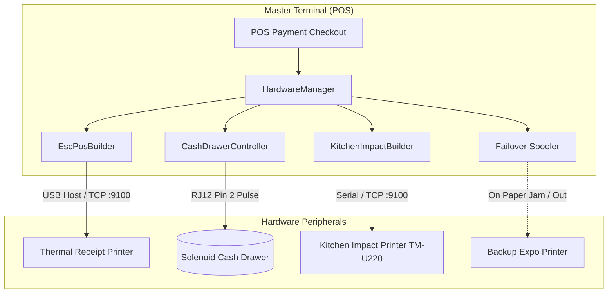

# Sprint Implementation Report & Technical Document: Phase 02 / Milestone 03

**Sprint ID:** `SPRINT_P02_M03`  
**Phase:** Phase 02 — In-Store Operations  
**Milestone:** Milestone 03 — Direct Hardware I/O — Printers & Cash Drawer  
**Version:** 1.0.0  
**Parent:** [MILESTONE03_INDEX.md](../MILESTONE03_INDEX.md)  
**Status:** 🟡 **DOCUMENT-BEFORE-CODE (DRAFTED FOR IMPLEMENTATION)**  

---

## 1. Executive Summary & Hardware Architecture

Sprint `SPRINT_P02_M03` delivers physical peripheral control for the Dinevique Master Terminal. Running directly on Android edge hardware with USB Host OTG and local Ethernet connectivity, the POS drives thermal customer receipt printers, high-heat kitchen impact printers, and cash drawers without intermediate cloud or print server layers:
- **Receipt Printing:** Binary ESC/POS command pipeline rendering 80mm high-density thermal receipts (48 columns) with brand headers, itemized totals, modifier deltas, and partial guillotine cuts.
- **Kitchen Printing:** 9-pin dot matrix impact stream with dynamic two-color ribbon switching (`RED` for modifier subtractions, allergy warnings, and course fires; `BLACK` for standard items).
- **Cash Drawer Kick:** Direct solenoid pulse generation over RJ12 printer auxiliary port or USB relay, guaranteeing $< 100\text{ms}$ drawer kick SLA upon cash settlement.
- **Peripheral Failover:** Automated printer health telemetry (paper low, paper out, cover open) with automatic spooling and backup printer rerouting.

---

## 2. ESC/POS Command Byte Specification

### 2.1 Thermal Receipt Command Set (80mm / 48 Columns)

| Command | Byte Sequence (Hex) | Purpose |
| :--- | :--- | :--- |
| `INIT` | `1B 40` | Initialize printer hardware and clear print buffer |
| `ALIGN_LEFT` | `1B 61 00` | Left-justify text |
| `ALIGN_CENTER`| `1B 61 01` | Center-justify text (used for Brand Header & QR) |
| `ALIGN_RIGHT` | `1B 61 02` | Right-justify text |
| `BOLD_ON` | `1B 45 01` | Turn bold text emphasis ON |
| `BOLD_OFF` | `1B 45 00` | Turn bold text emphasis OFF |
| `FONT_NORMAL` | `1D 21 00` | Normal text character size (1x width, 1x height) |
| `FONT_DOUBLE` | `1D 21 11` | Double-width & double-height text |
| `CUT_PARTIAL` | `1D 56 42 03` | Feed 3 lines and execute partial guillotine cut |
| `DRAWER_KICK` | `1B 70 00 19 FA` | Send 50ms pulse to RJ12 Pin 2 to kick cash drawer |

### 2.2 Kitchen Impact Two-Color Ribbon Command Set
For 9-pin impact printers (e.g., Epson TM-U220, Star SP700):

| Command | Byte Sequence (Hex) | Function |
| :--- | :--- | :--- |
| `RIBBON_BLACK` | `1B 72 00` | Switch print head ribbon to Black |
| `RIBBON_RED` | `1B 72 01` | Switch print head ribbon to Red (allergies, fire tags, exclusions) |
| `BUZZER_ALARM` | `1B 1E` | Trigger internal hardware chime on new kitchen order |

---

## 3. Solenoid Cash Drawer Controller

### 3.1 Pulse Generation & Latency SLA
- **Trigger Condition:** Cash payment committed in POS workspace or "No-Sale" manager action.
- **Pulse Parameters:** 
  $$\text{Pin} = 0 \text{ (RJ12 Pin 2)}, \quad t_1 = 25 \times 2\text{ms} = 50\text{ms (ON)}, \quad t_2 = 250 \times 2\text{ms} = 500\text{ms (OFF)}$$
- **Latency Requirement:** The physical command must dispatch to the printer within $< 100\text{ms}$ of payment confirmation, verified via local monotonic timing.
- **Auditing:** Every manual drawer open ("No-Sale") generates an audit event containing the manager PIN, employee name, timestamp, and optional reason code.

---

## 4. Hardware Manager & Failover Routing

### 4.1 Printer Status Telemetry
Status query command `DLE EOT 4` (`0x10, 0x04, 0x04`) returns real-time paper detector flags:
- `Bit 5 & 6 == 1`: Paper roll is completely out.
- `Bit 2 & 3 == 1`: Paper roll is low (warning only).
- `Bit 0 == 1`: Cover is open.

### 4.2 Failover Spooling Architecture
1. When a print job is dispatched, `HardwareManager` checks the status of the primary printer.
2. If the primary printer is `OFFLINE` or `OUT_OF_PAPER`:
   - The job is immediately rerouted to the pre-configured `fallbackPrinterId`.
   - A header is prepended to the receipt: `*** REROUTED FROM FRONT COUNTER - OUT OF PAPER ***`.
   - The POS UI displays a non-blocking toast alert: `"Printer 01 out of paper. Receipt rerouted to Bar Printer."`.
3. If all printers are offline, the raw ESC/POS byte array is queued in Room SQLite `outbound_print_queue` and drained once connection is restored.

---

## 5. Verification & Test Plan

1. **ESC/POS Bytecode Integrity Test:**
   - Verify byte stream structure: `INIT` $\rightarrow$ `ALIGN_CENTER` $\rightarrow$ Brand Header $\rightarrow$ Item Rows $\rightarrow$ `BOLD_ON` Total $\rightarrow$ `CUT_PARTIAL`.
   - Verify 48-column tabular spacing formatting.
2. **Two-Color Ribbon Switching Test:**
   - Verify `0x1B 0x72 0x01` is emitted immediately preceding allergy warnings and "NO ONIONS" exclusions.
   - Verify `0x1B 0x72 0x00` is restored for standard items.
3. **Cash Drawer Kick Pulse Test:**
   - Verify `0x1B 0x70 0x00 0x19 0xFA` is generated upon cash settlement.
   - Verify monotonic execution latency $< 100\text{ms}$.
4. **Paper-Out Failover Rerouting Test:**
   - Mock a primary printer in `OUT_OF_PAPER` state.
   - Verify job automatically reroutes to backup printer with reroute header.

---
_Technical Document | Parent: [MILESTONE03_INDEX.md](../MILESTONE03_INDEX.md) | Status: APPROVED FOR CODE_
