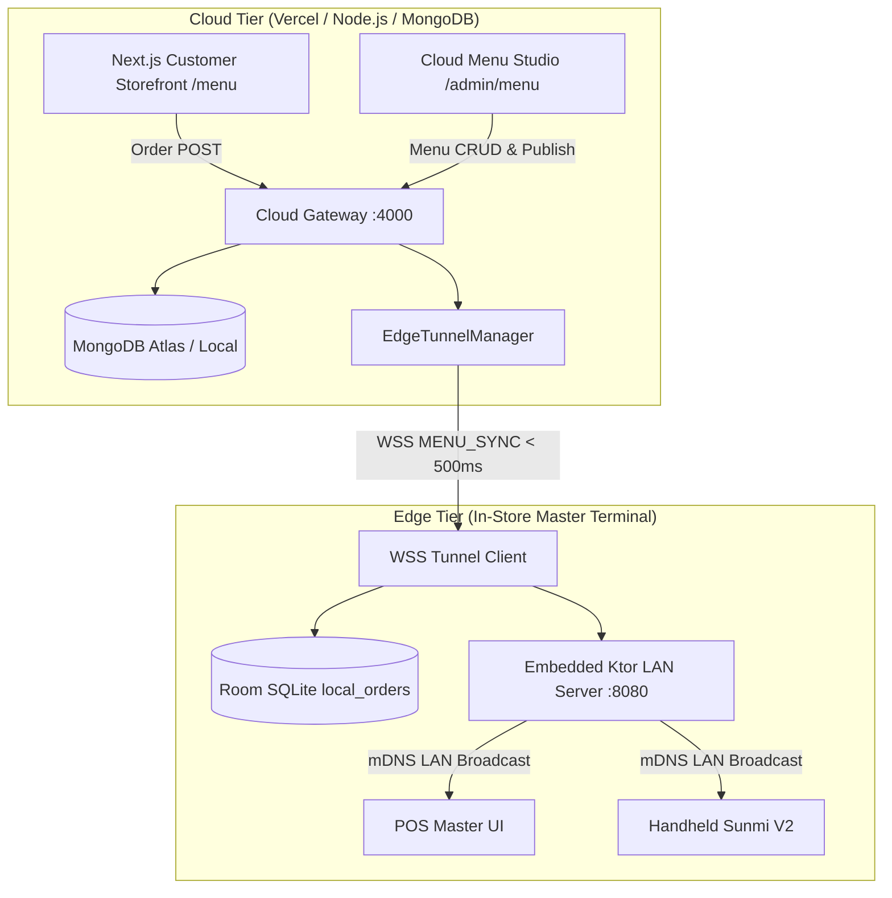

# Sprint Implementation Report & Technical Document: Phase 03 / Milestone 01

**Sprint ID:** `SPRINT_P03_M01`  
**Phase:** Phase 03 — Cloud & Omnichannel  
**Milestone:** Milestone 01 — Next.js Storefront & Cloud Menu Studio  
**Version:** 1.0.0  
**Parent:** [MILESTONE01_INDEX.md](../MILESTONE01_INDEX.md)  
**Status:** 🟡 **DOCUMENT-BEFORE-CODE (DRAFTED FOR IMPLEMENTATION)**  

---

## 1. Executive Summary & Architecture Overview

Sprint `SPRINT_P03_M01` establishes the omnichannel cloud tier of the Dinevique platform. Connecting consumers and restaurant management to the edge ecosystem:
- **Consumer Online Storefront (`/menu`):** Next.js 14 App Router application delivering an elegant, luxury online ordering experience with category filtering, responsive item cards, interactive modifier customization with validation, and a sliding cart drawer.
- **Cloud Menu Studio (`/admin/menu`):** Single-pane-of-glass administrative interface for managing categories, items, prices, prep stations, and nested modifier trees across restaurant locations.
- **WSS Edge Push Pipeline (`MENU_SYNC`):** Publishes menu revisions from the Cloud Gateway directly down to connected Master Terminals over persistent bidirectional WSS edge tunnels in $< 500\text{ms}$.



---

## 2. Next.js Storefront Specification (`/menu`)

### 2.1 Visual Design & Component Hierarchy
- **Header:** Sticky glassmorphism header with Dinevique logo, restaurant location selector, search bar, and cart badge with dynamic item count.
- **Category Navigation:** Horizontal pill list with active state highlighting (Brand Amber fill `#D4820A` and Brand Ink `#1A1A1A` text).
- **Product Card Grid:** High-contrast cards featuring item name, description snippet, station tag, formatted price, and "Add to Order" action.
- **Modifier Modal:**
  - Enforces `minSelection` (e.g. Temperature required for steaks) and `maxSelection`.
  - Dynamically computes item total:
    $$\text{ItemTotalCents} = \text{BasePriceCents} + \sum \text{SelectedModifierPriceDeltaCents}$$
  - Primary button disabled until all mandatory requirements are satisfied.
- **Sliding Cart Drawer:**
  - Displays list of items with selected modifiers.
  - Real-time calculations: Subtotal, Tax (8.875%), Order Total.
  - Checkout CTA triggering order dispatch to Cloud Gateway.

---

## 3. Cloud Admin Menu Studio Specification (`/admin/menu`)

### 3.1 Hierarchical Catalog Management
- **Category Management:** Create, reorder, and rename menu categories (`Appetizers`, `Mains`, `Desserts`, `Beverages`).
- **Item Management:** Edit name, description, base price in cents, tax rate percentage, prep station (`GRILL`, `FRY`, `SALAD`, `PASTRY`, `EXPO`, `BAR`), and modifier group associations.
- **Modifier Group Builder:** Define min/max rules, required flags, and individual options with positive or zero price deltas.
- **Edge Deployment:** "Publish to Edge Terminals" button triggers immediate distribution down to in-store hardware.

---

## 4. Cloud Gateway Menu API & Edge Sync Specification

### 4.1 Endpoints Specification

| Method | Path | Request Body | Description |
| :--- | :--- | :--- | :--- |
| `GET` | `/api/v1/menu` | Query: `?restaurantId=...` | Returns active canonical menu hierarchy from MongoDB |
| `POST` | `/api/v1/menu` | Canonical Menu JSON | Creates or updates menu catalog in MongoDB |
| `POST` | `/api/v1/menu/publish` | `{ restaurantId, menuId }` | Saves revision & broadcasts `MENU_SYNC` to edge tunnels |

### 4.2 `MENU_SYNC` Envelope Protocol
```json
{
  "eventId": "evt-sync-9842",
  "eventType": "MENU_SYNC",
  "restaurantId": "rest_nyc_01",
  "timestampEpochMs": 1700000000000,
  "payload": {
    "menuId": "menu_001",
    "updatedAtIso": "2026-10-20T00:46:00.000Z",
    "categoriesCount": 5,
    "itemsCount": 24,
    "categories": [ ... ]
  }
}
```

---

## 5. Verification & Test Plan

1. **Menu API Retrieval & Upsert:**
   - Verify `GET /api/v1/menu` returns valid menu structure.
   - Verify `POST /api/v1/menu` persists updates and updates revision timestamp.
2. **Edge Tunnel `MENU_SYNC` Broadcast:**
   - Connect mock Master Terminal WebSocket to `/ws/edge-tunnel`.
   - Call `POST /api/v1/menu/publish`.
   - Verify WebSocket client receives the `MENU_SYNC` envelope with matching payload in $< 500\text{ms}$.
3. **Storefront Cart Math:**
   - Verify accurate subtotal calculation with modifiers.
   - Verify tax calculation and total formatting.

---
_Technical Document | Parent: [MILESTONE01_INDEX.md](../MILESTONE01_INDEX.md) | Status: APPROVED FOR CODE_
