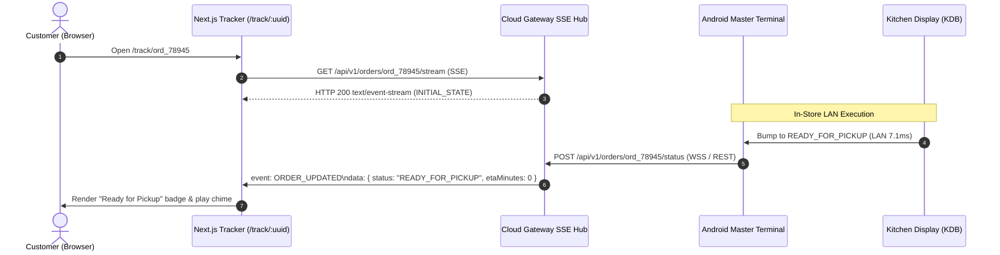

# Sprint Implementation Report & Technical Specification: SPRINT_P03_M02

**Sprint ID:** `SPRINT_P03_M02`  
**Milestone:** Phase 03 — Milestone 02: Live Order Status Tracker & Analytics  
**Parent Milestone Index:** [MILESTONE02_INDEX.md](../MILESTONE02_INDEX.md)  
**Parent Roadmap:** [SPRINT_P03_M02_IMPLEMENTATION_ROADMAP.md](SPRINT_P03_M02_IMPLEMENTATION_ROADMAP.md)  
**Status:** 🟡 **DOCUMENTATION COMMITTED (PRE-CODE)**  
**Version:** 1.0.0  

---

## 1. System Architecture & Real-Time SSE Pipeline

Milestone 02 closes the operational loop between in-store edge operations and omnichannel stakeholders:
1. **Customer Order Transparency:** When kitchen personnel bump an order on the Android Kitchen Display (KDB Compose screen), the Master Terminal sends an asynchronous status update to the Cloud Gateway via the existing WSS tunnel or HTTP REST ingest.
2. **Server-Sent Events (SSE) Broadcast Hub:** The Cloud Gateway routes this update to all active HTTP SSE streaming connections registered for that `orderUuid`.
3. **Enterprise Edge Health Telemetry:** Active Master Terminals and Handhelds send periodic heartbeats (default: 30s) providing immediate visibility into LAN reachability, local sync queue backlogs, and hardware peripheral status.
4. **Cloud Analytics Engine:** Ingested orders are aggregated in memory / MongoDB to power executive dashboards without impacting local LAN edge POS latency.



---

## 2. Server-Sent Events (SSE) Protocol Specification

### 2.1 Connection Handshake & Lifecycle
- **Endpoint:** `GET /api/v1/orders/:orderUuid/stream`
- **Response Headers:**
  ```http
  Content-Type: text/event-stream
  Cache-Control: no-cache, no-transform
  Connection: keep-alive
  X-Accel-Buffering: no
  Access-Control-Allow-Origin: *
  ```
- **Connection Keep-Alive:** Periodic comment ping `: ping\n\n` emitted every 15 seconds to prevent intermediate proxy timeouts.
- **Event Framing:**
  ```http
  event: ORDER_UPDATED
  data: {"orderUuid":"ord_78945","status":"IN_PREPARATION","etaMinutes":12,"estimatedReadyTime":"2026-10-20T01:15:00Z","pickupCode":"B-42","items":[{"name":"Prime Ribeye Steak","quantity":1,"modifiers":["Medium Rare","Truffle Butter"]}],"subtotalCents":4800,"taxCents":408,"totalCents":5208}
  ```

### 2.2 Client-Side Resiliency & Fallback
The Next.js client (`EventSource` wrapper) implements:
1. Automatic exponential backoff reconnection (1s, 2s, 4s, up to 10s max).
2. Polling fallback (`GET /api/v1/orders/:orderUuid`) if `EventSource` is unsupported or repeatedly severed.

---

## 3. Order Status State Machine & Visual Representation

The order lifecycle conforms to four sequential customer-facing states:

| Status Code | Customer-Facing Title | Description | ETA Calculation |
| :--- | :--- | :--- | :--- |
| `ORDER_PLACED` | Order Received | Kitchen has received the ticket on the master rail | +20–25 minutes |
| `IN_PREPARATION` | In the Kitchen | Line chefs are firing hot items | +10–15 minutes |
| `READY_FOR_PICKUP` | Ready for Pickup | Order plated, bagged, and placed at the collection counter | 0 minutes |
| `COMPLETED` | Order Fulfilled | Customer received items and transaction finalized | N/A |

---

## 4. Analytics Aggregation Mathematical Model

The Cloud Analytics Engine calculates core hospitality metrics across selected date ranges:

### 4.1 Financial Metrics
- **Gross Sales ($G$):**
  $$G = \sum_{i=1}^{M} \text{Subtotal}_i$$
- **Net Revenue ($N$):**
  $$N = G - \sum_{i=1}^{M} \text{Discounts}_i - \sum_{i=1}^{M} \text{Refunds}_i$$
- **Average Check Size ($\bar{C}$):**
  $$\bar{C} = \frac{G}{M} \quad (\text{where } M \text{ is total valid order count})$$
- **Labor Cost Ratio ($LCR$):**
  $$LCR = \left( \frac{\text{Total Scheduled Labor Cents}}{G} \right) \times 100\%$$

### 4.2 Category Revenue Distribution
$$\text{CategoryShare}_k = \left( \frac{\sum \text{Revenue}_{k}}{G} \right) \times 100\%$$

### 4.3 Hourly Volume Heatmap
Aggregated into 24 one-hour buckets ($h \in [0, 23]$) representing order counts and total dollar volume, highlighting lunch peak (12:00–14:00) and dinner peak (18:00–21:00).

---

## 5. Master Terminal Heartbeat & Edge Health Schema

Edge terminals post a structured telemetry envelope every 30 seconds to `POST /api/v1/terminals/heartbeat`:

```typescript
export interface TerminalHeartbeatPayload {
  terminalId: string;
  role: 'MASTER_TERMINAL' | 'HANDHELD_ORDER_PAD' | 'KDB_SCREEN';
  restaurantId: string;
  lanIp: string;
  lanPort: number;
  batteryLevelPercent?: number;
  isCharging?: boolean;
  lanPingLatencyMs: number;
  offlineQueueDepth: number;
  peripherals: {
    thermalPrinter: 'OK' | 'PAPER_LOW' | 'PAPER_OUT' | 'OFFLINE';
    kitchenImpact: 'OK' | 'RIBBON_WARNING' | 'OFFLINE';
    cashDrawer: 'CLOSED' | 'OPEN' | 'DISCONNECTED';
  };
  lastHeartbeatTime: string;
}
```

The cloud health registry marks any terminal not reporting within **90 seconds** as `OFFLINE` with amber/slate alert badges.

---

## 6. Dinevique Brand Tokens & Design System Enforcement

All Next.js pages strictly implement Dinevique Brand Standards:
- **Palette Tokens:**
  - Background: Brand Onyx (`#0D0D0D`)
  - Elevated Surfaces & Cards: Dark charcoal `#141414`, borders `#262626`
  - Secondary Accents: Brand Slate (`#1E2A38`)
  - Primary Accent: Brand Amber (`#D4820A`)
  - Dark Contrast Foreground: Brand Ink (`#1A1A1A`)
- **WCAG AA Contrast Guarantee:** All solid buttons filled with Brand Amber (`#D4820A`) MUST use Brand Ink (`#1A1A1A`) text color, achieving 4.5:1+ contrast.
- **Typography:** Inter, tight tracking, crisp numerical tabular fonts for prices and timers.
- **Copy Constraints:** Absolutely zero exclamation marks across all tracker messages, error banners, and analytical tooltips.

---

## 7. Automated Test Plan

The automated verification suite (`apps/cloud-gateway/test/order-tracker-and-analytics.test.mjs`) tests:
1. **SSE Handshake & Streaming:** Connecting to `GET /api/v1/orders/:orderUuid/stream` returns 200 with `text/event-stream` and receives instant initial state.
2. **Push Event Delivery:** `POST /api/v1/orders/:orderUuid/status` triggers SSE `ORDER_UPDATED` event delivery to the listener within $< 500\text{ms}$.
3. **Heartbeat Registry:** Terminals post heartbeats, and `GET /api/v1/terminals` correctly returns their health status, latency, and peripheral flags.
4. **Analytics Aggregation:** Simulating a batch of multi-category orders produces penny-perfect gross sales, net revenue, and category percentage breakdown.

---
_Technical Specification: SPRINT_P03_M02 | Phase 03: Milestone 02 | Status: DOCUMENTATION COMMITTED (PRE-CODE)_
