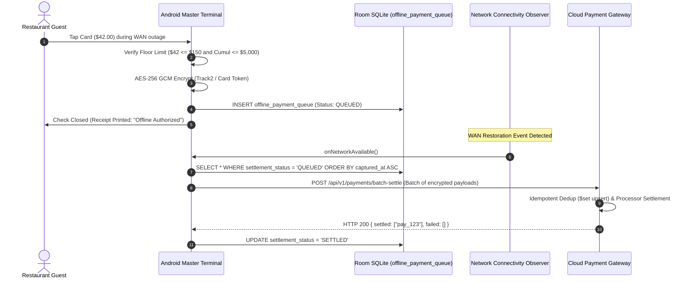

# Sprint Implementation Report & Technical Specification: SPRINT_P04_M01

**Sprint ID:** `SPRINT_P04_M01`  
**Milestone:** Phase 04 — Milestone 01: Store-and-Forward Offline Payments  
**Parent Milestone Index:** [MILESTONE01_INDEX.md](../MILESTONE01_INDEX.md)  
**Parent Roadmap:** [SPRINT_P04_M01_IMPLEMENTATION_ROADMAP.md](SPRINT_P04_M01_IMPLEMENTATION_ROADMAP.md)  
**Status:** 🟡 **DOCUMENTATION COMMITTED (PRE-CODE)**  
**Version:** 1.0.0  

---

## 1. Cryptographic Architecture (AES-256 GCM)

To comply with PCI-DSS Level 1 requirements and ensure cardholder data is never stored in plaintext on edge terminals:

1. **Cipher Algorithm:** `AES/GCM/NoPadding` (Galois/Counter Mode).
2. **Key Derivation & Storage:** 256-bit symmetric encryption key generated inside Android KeyStore (`AndroidKeyStore`), hardware-isolated with `KeyProperties.PURPOSE_ENCRYPT or KeyProperties.PURPOSE_DECRYPT`.
3. **Initialization Vector (IV):** A unique, non-repeating 12-byte random IV (`SecureRandom`) generated per transaction authorization.
4. **Ciphertext Storage Format:**
   $$\text{EncryptedPayload} = \text{Base64}\Big( \text{IV} \,\|\, \text{Ciphertext} \,\|\, \text{AuthTag} \Big)$$
   - IV: 12 bytes
   - Ciphertext + Tag: Variable length + 16 bytes (128-bit authentication tag)
5. **Decryption Guarantee:** Ciphertext cannot be decrypted without the exact hardware key and detects any tampering with ciphertext bytes.

---

## 2. Risk Modeling & Floor Limits

During WAN interruptions, the terminal operates autonomously. To protect against unauthorized fraud while preserving uninterrupted guest checkout:

### 2.1 Single Transaction Floor Limit
$$A_i \le S_{\max} = 15,000 \text{ cents} \quad (\$150.00)$$
If a guest check total exceeds $150.00, the POS alerts the server with `EXCEEDS_SINGLE_TRANSACTION_LIMIT` and requests an alternative payment tender (cash or manager override).

### 2.2 Cumulative Queue Ceiling
$$\sum_{j \in \text{Queued}} A_j + A_i \le C_{\max} = 500,000 \text{ cents} \quad (\$5,000.00)$$
If the cumulative backlog of un-settled offline authorizations reaches $5,000.00, the terminal enters protected offline mode, halting additional offline credit authorizations until WAN is restored.

### 2.3 Expiration Time-to-Live (TTL)
Any queued offline authorization older than **72 hours** is flagged as `EXPIRED_RETRY_MANUAL` to prevent chargeback penalties from stale processor submissions.

---

## 3. Auto-Drain WAN Settlement Pipeline



---

## 4. Cloud Payment Gateway Schemas

### 4.1 Payment Record Schema
```typescript
export interface PaymentRecord {
  paymentUuid: string;
  clientOrderUuid: string;
  restaurantId: string;
  amountCents: number;
  tipCents: number;
  cardLast4: string;
  cardBrand: string;
  isOfflineAuthorized: boolean;
  settlementStatus: 'AUTHORIZED' | 'SETTLED' | 'FAILED';
  authCode: string;
  capturedAtEpochMs: number;
  settledAtEpochMs?: number;
}
```

### 4.2 Batch Settlement Request Payload
```typescript
export interface BatchSettleRequest {
  restaurantId: string;
  terminalId: string;
  payments: Array<{
    paymentUuid: string;
    clientOrderUuid: string;
    amountCents: number;
    tipCents: number;
    encryptedCardPayload: string;
    cardLast4: string;
    cardBrand: string;
    capturedAtEpochMs: number;
  }>;
}
```

---

## 5. Automated Test Plan

1. **Cryptographic Round-trip:** Encrypting sensitive card payload yields Base64 ciphertext, and decrypting returns identical card token with 0 corruption.
2. **Floor Limit Enforcement:** Enqueueing $160.00 fails with single limit violation; enqueueing transactions exceeding $5,000 cumulative fails with risk ceiling violation.
3. **Idempotent Batch Settlement:** Submitting a batch of 10 offline transactions returns 10 settled; resubmitting the same batch returns 10 settled with 0 duplicate records.

---
_Technical Specification: SPRINT_P04_M01 | Phase 04: Milestone 01 | Status: DOCUMENTATION COMMITTED (PRE-CODE)_
