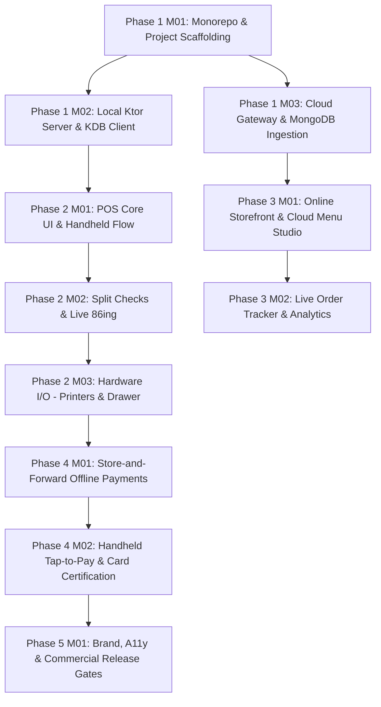

# Requirements Traceability Matrix (RTM): Dinevique Platform

**Document ID:** `REQUIREMENTS_TRACEABILITY_MATRIX`  
**Parent:** [SRS_INDEX.md](SRS_INDEX.md)  
**Cross-References:** [USER_STORIES.md](USER_STORIES.md), [SYSTEM_TRACEABILITY_AND_TEST_CASES.md](../SOURCES/SYSTEM_TRACEABILITY_AND_TEST_CASES.md)  
**Version:** 1.0.0  
**Status:** Approved Baseline  

---

## 1. Overview & Verification Methodology

The Requirements Traceability Matrix (RTM) establishes a strict 1-to-1 and 1-to-N chain of custody across the Dinevique SDLC. No code is implemented without a corresponding requirement and test case; no requirement exists without an architectural contract and verification strategy.

### Traceability Vector
$$\text{PRD Feature} \longrightarrow \text{SRS Functional Req} \longrightarrow \text{User Story} \longrightarrow \text{Module Spec} \longrightarrow \text{Contract/Schema} \longrightarrow \text{Verification Test} \longrightarrow \text{Milestone/Sprint}$$

---

## 2. Complete Bidirectional Matrix

| PRD Ref | SRS Functional Req | User Story ID | Module Spec | Interface / Data Contract | Automated Test Case | Target Sprint | Verification Method |
| :--- | :--- | :--- | :--- | :--- | :--- | :--- | :--- |
| **POS-1** | `FR-POS-001` (Ktor Orchestrator) | `US-POS-001` | `SPEC-POS-MASTER.md` | `EVENT-SYS-DISCOVERY.md` | `TC-POS-001` | Phase 01 / Sprint P01_M01 | **T** (Test) |
| **POS-2** | `FR-POS-002` (Fast PIN & RBAC) | `US-POS-002` | `SPEC-POS-MASTER.md` | `SCHEMA-USER-SESSION.md` | `TC-POS-002` | Phase 01 / Sprint P01_M01 | **T** (Test) |
| **POS-3** | `FR-POS-003` (Floor Map & Coursing)| `US-POS-003` | `SPEC-POS-MASTER.md` | `EVENT-ORDER-CREATE.md` | `TC-POS-003` | Phase 02 / Sprint P02_M01 | **D** (Demo) |
| **POS-4** | `FR-POS-004` (Split Checks/Tenders)| `US-POS-004` | `SPEC-POS-MASTER.md` | `SCHEMA-ORDER.md` | `TC-POS-004` | Phase 02 / Sprint P02_M02 | **T** (Test) |
| **POS-5** | `FR-POS-005` (Hardware I/O Engine)| `US-POS-005` | `SPEC-POS-HARDWARE.md`| `CONTRACT-HARDWARE-IO.md`| `TC-POS-005` | Phase 02 / Sprint P02_M03 | **D** (Demo) |
| **POS-6** | `FR-POS-006` (Store & Forward Pay) | `US-POS-006` | `SPEC-POS-MASTER.md` | `SCHEMA-OFFLINE-PAYMENT.md`|`TC-POS-006` | Phase 04 / Sprint P04_M01 | **T** (Test) |
| **KDB-1** | `FR-KDB-001` (Real-Time Stream) | `US-KDB-001` | `SPEC-KITCHEN-KDB.md` | `EVENT-TICKET-RECEIVED.md` | `TC-KDB-001` | Phase 01 / Sprint P01_M02 | **T** (Test) |
| **KDB-2** | `FR-KDB-002` (Bump Lifecycle) | `US-KDB-002` | `SPEC-KITCHEN-KDB.md` | `EVENT-TICKET-BUMPED.md` | `TC-KDB-002` | Phase 01 / Sprint P01_M02 | **D** (Demo) |
| **KDB-3** | `FR-KDB-003` (Station Filter & Recall)|`US-KDB-003` | `SPEC-KITCHEN-KDB.md` | `EVENT-TICKET-RECALLED.md` | `TC-KDB-003` | Phase 02 / Sprint P02_M01 | **D** (Demo) |
| **KDB-4** | `FR-KDB-004` (Pass 86ing Broadcast) | `US-KDB-004` | `SPEC-KITCHEN-KDB.md` | `EVENT-ITEM-86.md` | `TC-KDB-004` | Phase 02 / Sprint P02_M02 | **T** (Test) |
| **HND-1** | `FR-HND-001` (3-Tap Mobile UI) | `US-HND-001` | `SPEC-HANDHELD-MOBILE.md`| `EVENT-ORDER-CREATE.md` | `TC-HND-001` | Phase 02 / Sprint P02_M01 | **I** (Inspection) |
| **HND-2** | `FR-HND-002` (LAN Proxy Sync) | `US-HND-002` | `SPEC-HANDHELD-MOBILE.md`| `CONTRACT-LAN-WEBSOCKET.md`|`TC-HND-002` | Phase 02 / Sprint P02_M01 | **T** (Test) |
| **HND-3** | `FR-HND-003` (Tableside Tap-to-Pay) | `US-HND-003` | `SPEC-HANDHELD-MOBILE.md`| `SCHEMA-PAYMENT-RECORD.md` | `TC-HND-003` | Phase 04 / Sprint P04_M02 | **T** (Test) |
| **ONL-1** | `FR-ONL-001` (SSR Digital Menu) | `US-ONL-001` | `SPEC-ONLINE-STOREFRONT.md`| `SCHEMA-MENU-CANONICAL.md`| `TC-ONL-001` | Phase 03 / Sprint P03_M01 | **T** (Test) |
| **ONL-2** | `FR-ONL-002` (WSS Edge Push) | `US-ONL-002` | `SPEC-ONLINE-STOREFRONT.md`| `EVENT-ORDER-CLOUD-INGEST.md`|`TC-ONL-002`| Phase 03 / Sprint P03_M01 | **T** (Test) |
| **ONL-3** | `FR-ONL-003` (Live Status Tracker) | `US-ONL-003` | `SPEC-ONLINE-STOREFRONT.md`| `EVENT-ORDER-STATUS-UPDATE.md`|`TC-ONL-003`| Phase 03 / Sprint P03_M02 | **D** (Demo) |
| **CLD-1** | `FR-CLD-001` (Hierarchical Menu Studio)|`US-CLD-001`| `SPEC-CLOUD-ADMIN.md` | `EVENT-MENU-SYNC.md` | `TC-CLD-001` | Phase 03 / Sprint P03_M01 | **D** (Demo) |
| **CLD-2** | `FR-CLD-002` (Idempotent Ingestion) | `US-CLD-002` | `SPEC-CLOUD-GATEWAY.md` | `CONTRACT-IDEMPOTENCY.md` | `TC-CLD-002` | Phase 01 / Sprint P01_M03 | **T** (Test) |
| **CLD-3** | `FR-CLD-003` (Analytics Dashboard) | `US-CLD-003` | `SPEC-CLOUD-ADMIN.md` | `API-ANALYTICS-SUMMARY.md` | `TC-CLD-003` | Phase 03 / Sprint P03_M02 | **D** (Demo) |

---

## 3. Non-Functional Traceability Matrix

| NFR ID | Category | Metric Target | Verification Test / Method | Target Sprint |
| :--- | :--- | :--- | :--- | :--- |
| `NFR-PERF-001` | UI Latency | Touch response < 100ms | Macrobenchmark Compose Suite | Phase 01 / Sprint P01_M01 |
| `NFR-PERF-002` | LAN Latency | Handheld-to-KDB < 400ms | Automated Wi-Fi Timing Test | Phase 01 / Sprint P01_M02 |
| `NFR-PERF-003` | Peripheral Latency | Cash drawer kick < 100ms, print < 150ms | Hardware Protocol Probe | Phase 02 / Sprint P02_M03 |
| `NFR-REL-001` | Resiliency | Zero orders lost during WAN failure | Network Chaos Simulation (WAN Drop) | Phase 01 / Sprint P01_M01 |
| `NFR-REL-002` | Queue Drain | Outbound queue drains in FIFO < 30s | Store-and-Forward Drain Test | Phase 04 / Sprint P04_M01 |
| `NFR-SEC-001` | Cryptography | AES-256 GCM in Android KeyStore | Security Static & Dynamic Audit | Phase 04 / Sprint P04_M01 |
| `NFR-SEC-003` | Authentication | PBKDF2/Argon2 PIN hashing | Cryptographic Unit Test Suite | Phase 01 / Sprint P01_M01 |
| `NFR-A11Y-001`| Contrast | WCAG AA (>= 4.5:1 text, >= 3.0:1 UI) | Automated Axe-Core & Compose A11y | All Sprints |
| `NFR-TONE-001` | Voice & Copy | Zero exclamation marks; active verbs | Automated Linter / PR Compliance Gate | All Sprints |

---

## 4. Phase & Milestone Dependency Cross-Reference

---
_Document: REQUIREMENTS_TRACEABILITY_MATRIX.md | Node: REQUIREMENTS | Parent: [SRS_INDEX.md](SRS_INDEX.md)_
